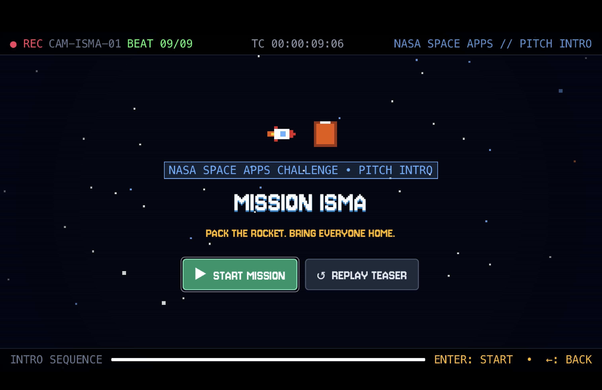
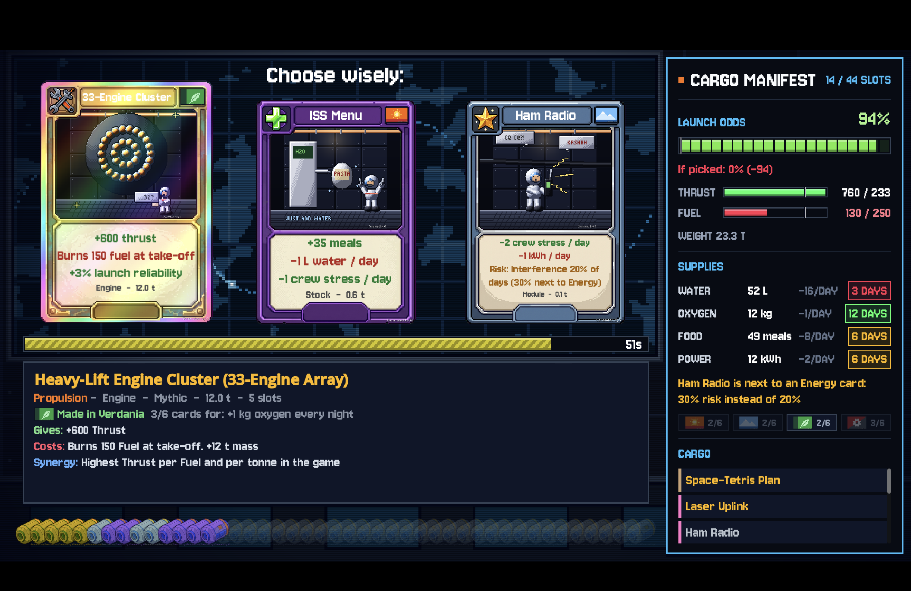
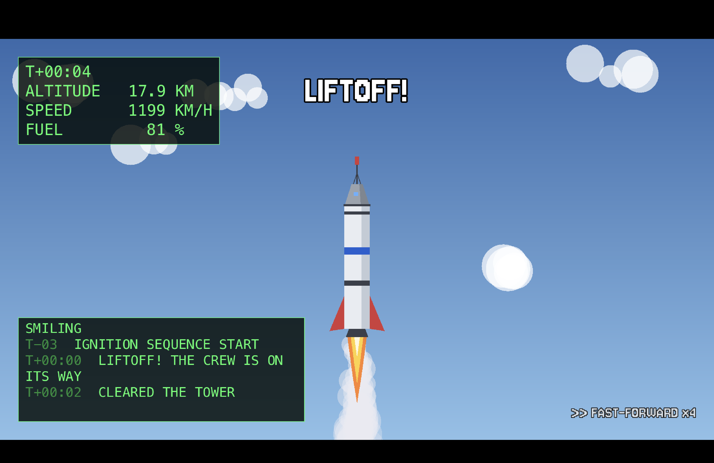
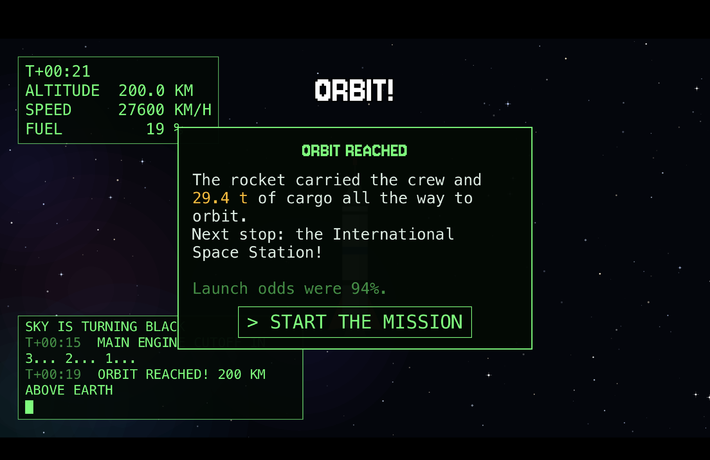
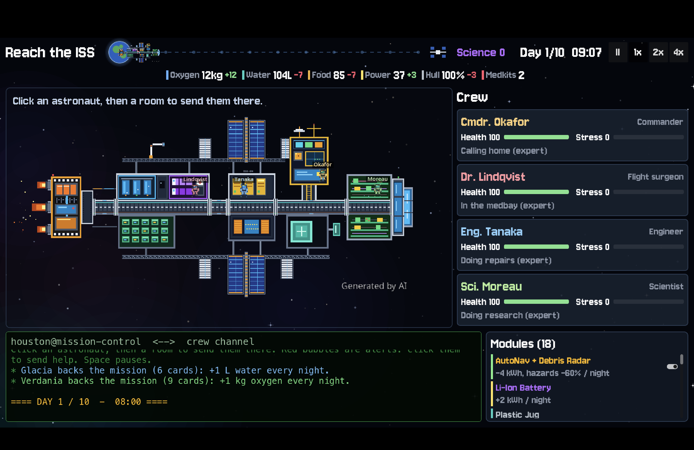

# 🚀 Mission Isma

> A space survival game where you manage your resources and face events to bring your mission to a successful end.

Project by **Team ISMA**, built in 48 hours for the **NASA Space Apps Challenge Toulouse 2026**, hosted by **IPSA Toulouse**.
🥈 **2nd place out of 12 teams.**







🎬 **Trailer:** [[video link]](https://youtu.be/EkpJkabX5yU)

---

## 🎯 The challenge

**Space Mission Design Game**: create an interactive game that lets players design, manage and simulate a complete space mission, balancing mission objectives, spacecraft design, budget, power, mass, communications and orbital constraints.

## 💡 Our idea

According to NASA's findings, space education is too fragmented and too theoretical: students learn each field separately, without seeing how systems affect each other in real time.

In space, everything is connected: a missing resource or an unexpected event can put the whole mission at risk. **Mission Isma** lets players experience this, from mission design to resource and event management.

## 🎮 The game

An interactive choice-based game that blends NASA data with survival gameplay. It is inspired by _60 Seconds!_ and adds **deck-building** and **rogue-like** mechanics.

- Design your mission and make engineering choices
- Manage limited resources
- React to events that happen during the mission
- Live with the consequences of every decision on the whole mission
- Start over, learn and anticipate

**Audience:** open to everyone, designed mainly for middle and high school students.

## 📚 Learning goals

At the end of a run, successful or not, players understand that:

1. A problem in one area affects the whole mission and its chances of survival.
2. Failing is normal: it means you have to start over and anticipate.

⚠️ Use of AI in this project

This project was built in 48 hours, with the goal of delivering something fast and functional. To reach that goal, most of the code and the assets were generated with AI tools.

The creative direction remained ours: the concept, the game design, the mechanics, the educational goals and the overall vision were conceived by the team. We chose what to build, reviewed and selected what the tools produced, and made every decision about how the game plays and feels. AI was a tool to speed up production, not a substitute for our ideas.

As a hackathon prototype, the code may therefore be uneven in quality and has not been fully cleaned up or refactored.

## 🛠️ Tech

- [Godot Engine](https://godotengine.org/) (version: **4.7.2**)

## ▶️ Run the game

1. Install [Godot](https://godotengine.org/download) (version **4.7.2**).
2. Clone the repository:
   ```bash
   git clone https://github.com/Kapsulon/nasa-space-app-challenge-2026.git
   ```
3. Open Godot, click **Import**, then select the `project.godot` file.
4. Run the project with **F5**.

## 📁 Project structure

| Folder     | Content                              |
| ---------- | ------------------------------------ |
| `assets/`  | Images, sounds and graphic resources |
| `scenes/`  | Game scenes                          |
| `prefabs/` | Reusable elements                    |
| `classes/` | Scripts and game logic               |
| `data/`    | Game data                            |
| `addons/`  | Godot plugins                        |
| `tools/`   | Utility tools                        |
| `docs/`    | Game Screenshots                     |

## 👥 The team

We were 6: 1 developer, 3 game designers, 2 on assets and UI/UX.

- [Théo BARY][link](https://github.com/Kapsulon)
- [Hinémoa THOMAS][link](https://github.com/printH17)
- [Pierre BOURGERY][link](https://github.com/Klaiveft)
- [Raphael CASTRES][link](https://github.com/Castres-Raphael)
- [Arnaud AUGAIT][link](https://github.com/ArnaudAugait)
- [Albéric FLOUR DE SAEGHER][link](https://github.com/albe2)

## 🙏 Acknowledgements

- **IPSA Toulouse** for hosting the event
- **Hakim Abid**, **Jean Favier--Siard** and the whole NASA Space Apps Challenge Toulouse organizing team
- All the **mentors** for their advice during the 48 hours
- **NASA** and space agencies for their open data
